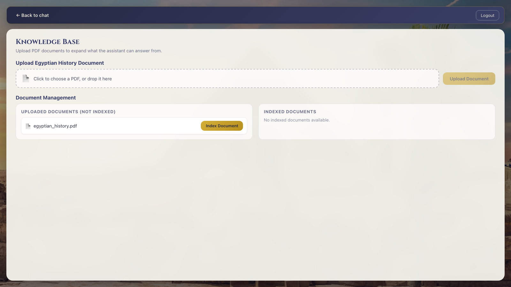
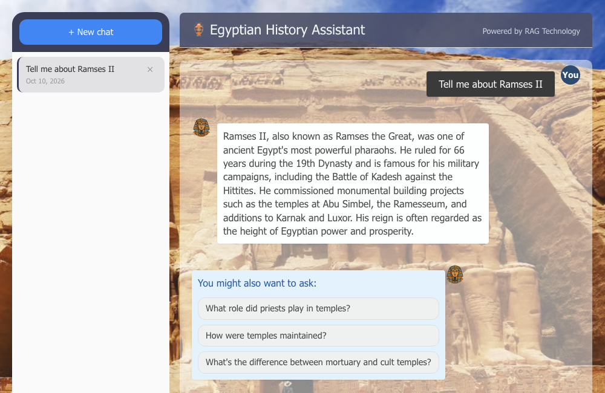

# Egyptian Tour Guide — Agentic RAG Chatbot

[](https://github.com/mahmoudhaytham25/egyptian-tour-guide-rag/actions/workflows/ci.yml)

A full-stack agentic chatbot for Egyptian tourism. It answers questions grounded in uploaded Egyptian history documents via a Retrieval-Augmented Generation (RAG) pipeline, holds natural multi-turn conversations, and can plan trip schedules (e.g. "a Thursday itinerary in Luxor").

## Features

- **Document-grounded Q&A** — upload Egyptian history PDFs (1000+ pages supported), index them, and ask questions; answers cite source document pages
- **Conversational agent** — single-call RAG handles questions and casual chat alike, with query enhancement for follow-ups ("When did *he* rule Egypt?")
- **Trip scheduling** — generates day itineraries using a curated monuments dataset (locations, opening times)
- **User accounts** — JWT auth, isolated per-user conversations, persistent chat history in MongoDB
- **Document management UI** — upload, index, and track indexing status from the React frontend

## Screenshots

| Home | Chat |
|---|---|
|  |  |

## Architecture

```
frontend/          React SPA (port 3000) — chat UI, document management, auth
     │
backend/           Express API (port 3001) — JWT auth, conversations, RAG endpoints
     │                              └─ calls model-server /query + /index over HTTP
model-server/      Flask model services via gunicorn (port 5050, internal
                   only — requires the backend's X-Internal-Token) + RAG pipeline
                   ├─ rag/          indexer, retriever, generator
                   ├─ models/       Gemini 3.8 Flash LLM + Gemini embeddings (gemini-embedding-001)
                   ├─ data/         uploaded PDFs (incl. bundled egyptian_history.pdf)
                   └─ times_places/ monument dataset for trip scheduling

MongoDB            users, conversations, chat history
```

## Stack

Python (Flask, PyMuPDF) · Node.js (Express) · React · MongoDB · Google Gemini 3.8 Flash + gemini-embedding-001 · JWT

## Getting Started

### Run with Docker (recommended)

The whole stack — frontend, backend, model server, and MongoDB — runs with one command:

```
cp .env.example .env   # then set GEMINI_API_KEY, JWT_SECRET and INTERNAL_API_TOKEN inside .env
docker compose up --build
```

Then open http://localhost:3000.

- **`GEMINI_API_KEY`** is required by the model server — get one at [Google AI Studio](https://aistudio.google.com/app/apikey).
- The frontend container also **reverse-proxies `/api/*` to the backend** (`frontend/nginx.conf`) — the bundle calls the API same-origin (`VITE_API_URL=/api`), so no CORS or CSP configuration is needed for the compose deploy. `CORS_ORIGIN` is only for frontends that bypass that proxy and call the backend cross-origin.
- **`JWT_SECRET`** and **`INTERNAL_API_TOKEN`** are required — compose refuses to start without them (no insecure defaults). Generate with `openssl rand -hex 32`. `INTERNAL_API_TOKEN` is the shared secret the backend sends to the model server as `X-Internal-Token` — the model server is not reachable from the host and rejects unauthenticated calls.
- `GEMINI_API_KEY` is required for indexing AND querying — embeddings run through the Gemini API too (`gemini-embedding-001`), so there is no model download and first start is fast. If you previously indexed with the old local model, re-index: the new embeddings are incompatible with old vector files.
- Named volumes keep MongoDB data, uploaded PDFs (`rag-data`, seeded with `data/egyptian_history.pdf`), and the generated vector index (`vector-store`) persistent across restarts. Upload a PDF + index it once (Documents UI) or re-index the bundled PDF after a fresh `up`.
- **Free-tier quota caveat:** on a free Google AI Studio key, generation (`gemini-3.8-flash`) is limited to ~5 requests/min and ~20 requests/day — and each user query fires *up to 2–3* generate calls (optional query enhancement + answer; itinerary asks add parameter extraction). On a rate-limit error the request retries on a lower-grade flash model (each model has a separate quota — override the chain with `GEMINI_FALLBACK_MODELS`). Embeddings count ~1 quota unit *per text* against ~100/min, so indexing the bundled 1,275-page PDF (~3,800 chunks) takes ~40 min of quota pacing. A paid key removes these limits.

### Run locally (without Docker)

1. **Model server** — `cd model-server && pip install -r requirements.txt && python model_server.py` (port 5050)
2. **API** — `cd backend && npm install && npm start` (port 3001)
3. **Frontend** — `cd frontend && npm install && npm run dev` (port 3000)

Requires MongoDB running locally and a `.env` file in **each** of `backend/` and `model-server/` — see the `.env.example` files and the detailed guide. Both services need `INTERNAL_API_TOKEN` set to the *same* value (the backend sends it as `X-Internal-Token` when calling the model server), and the backend additionally requires `JWT_SECRET` — both services fail fast without their secrets. Indexing goes through the model server's `POST /index` endpoint (async — poll via `GET /api/indexing-status`), so the model server must be running before indexing a document.

### Database migrations

The backend uses [migrate-mongo](https://github.com/seppevs/migrate-mongo) for MongoDB schema migrations (indexes, collections). Config: `backend/migrate-mongo-config.js` (reads `MONGODB_URI` like the app); migrations live in `backend/migrations/`. `docker compose up` runs them automatically — the backend entrypoint waits for MongoDB, applies pending migrations, then starts the API.

```bash
cd backend
npm run migrate:status        # show applied/pending migrations
npm run migrate:up            # apply pending migrations
npm run migrate:down          # roll back the last migration
npm run migrate:create -- my-change   # scaffold a new migration
```

**Full setup, env vars, and API reference:** [`docs/backend-and-model-server.md`](docs/backend-and-model-server.md) · **Frontend details:** [`frontend/README.md`](frontend/README.md)

## Deployment — AWS (CDK)

`infrastructure/` contains a complete IaC setup for running the app on AWS: one EC2 instance pulling pre-built images from ECR, deployed by a path-filtered CodeBuild pipeline. Four CDK stacks (`ecr`, `compute`, `deploy`, `ci`) are wired from `bin/app.ts`.

```
push to main → tests → diff paths → CodeBuild builds changed images → ECR → SSM redeploy on EC2
```

- GitHub Actions authenticates via **OIDC** — no AWS keys stored in secrets
- `JWT_SECRET` is generated into **Secrets Manager**; the box renders `.env` at boot — plaintext secrets never enter templates or state
- `docker-compose.base.yml` holds the shared stack (env, volumes, healthchecks); `docker-compose.yml` (dev — builds images, publishes dev ports) and `docker-compose.prod.yml` (prod — pulls ECR images) `include` it as thin overlays, so the usual `docker compose up` / `-f docker-compose.prod.yml` commands keep working
- The CI `deploy` job skips cleanly until the three GitHub entries are set — no AWS account needed to keep CI green

Full design, deploy steps and cost notes: [infrastructure/README.md](infrastructure/README.md)

## License

MIT — see [LICENSE](LICENSE).
